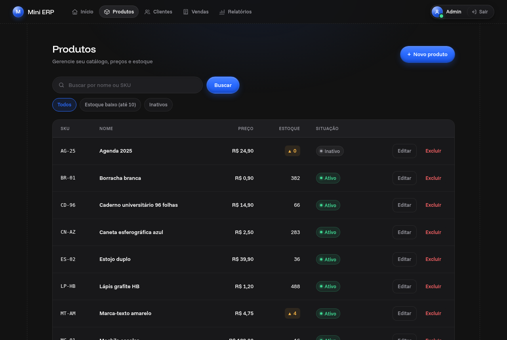
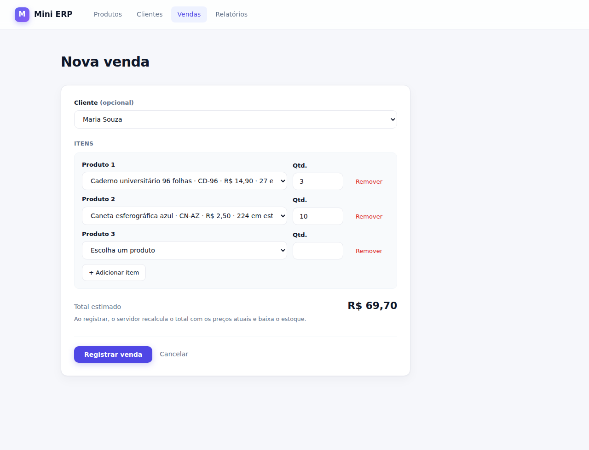
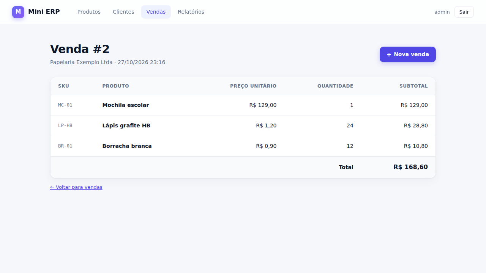
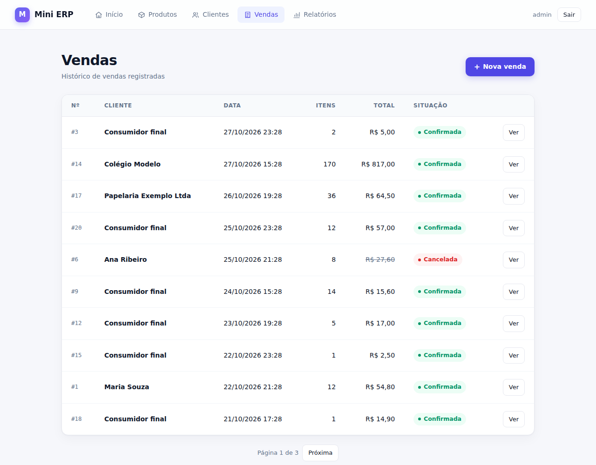
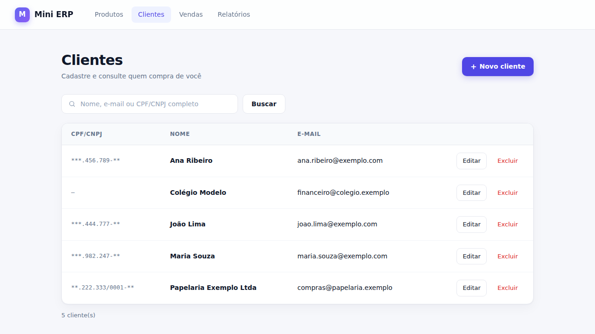
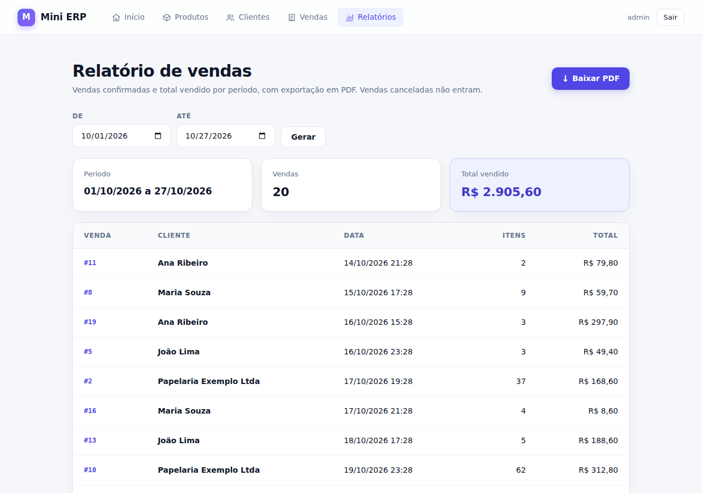
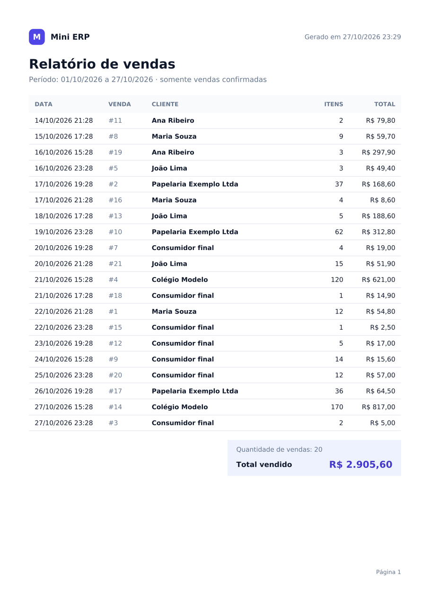
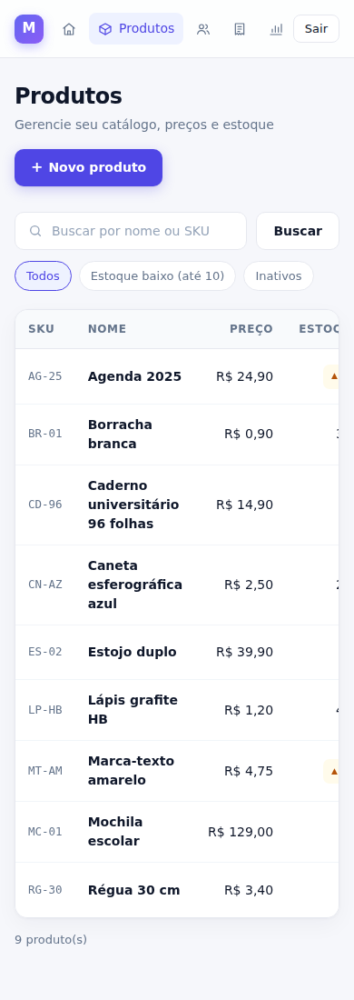

# Mini ERP — Gestão de Vendas e Estoque

> Projeto demonstrativo para praticar e apresentar conceitos de desenvolvimento backend com Java e Spring Boot, templates server-side, persistência relacional e geração de relatórios PDF.


O **Mini ERP** é uma aplicação de exemplo para pequenas operações comerciais. A proposta é centralizar o cadastro de produtos, clientes e vendas, acompanhar movimentações básicas de estoque e gerar relatórios de vendas em PDF.

Este repositório é um projeto de estudo e demonstração. Ajuste as funcionalidades e tecnologias descritas aqui ao que estiver realmente implementado no código.

## Objetivos

- Praticar a construção de uma aplicação web com Java e Spring Boot.
- Organizar o código em camadas, separando apresentação, regras de negócio e persistência.
- Persistir dados em PostgreSQL.
- Construir páginas server-side com Thymeleaf.
- Gerar relatórios em PDF com JasperReports.
- Demonstrar validação de dados, tratamento de erros e testes automatizados.

## Funcionalidades planejadas

### Cadastros
- [x] Cadastro, consulta, edição e exclusão de produtos.
- [x] Cadastro, consulta, edição e exclusão de clientes.
- [x] Listagem com paginação e busca (produtos e clientes).
- [x] Validação de campos obrigatórios e dados inválidos (produtos e clientes).

### Vendas e estoque
- [x] Registrar uma venda com um ou mais itens.
- [x] Calcular subtotal e total no servidor.
- [x] Atualizar o estoque ao confirmar uma venda.
- [x] Impedir vendas com quantidade maior que o estoque disponível.
- [x] Registrar data, itens, quantidades e preços praticados na venda.
- [x] Garantir consistência transacional entre venda e estoque.

### Relatórios
- [x] Gerar relatório de vendas por período.
- [x] Exibir total vendido e quantidade de vendas.
- [x] Exportar relatório em PDF usando JasperReports.
- [x] Tratar períodos inválidos e resultados vazios.

### Qualidade e manutenção
- [x] Testes unitários para regras de negócio (produtos e clientes).
- [x] Testes de integração para persistência e endpoints (produtos e clientes).
- [x] Mensagens de erro claras para o usuário.
- [x] Instruções de execução reproduzíveis.

> Marque os itens conforme forem realmente implementados. Não apresente funcionalidades planejadas como já concluídas.

## Stack tecnológica

| Tecnologia | Uso proposto |
|---|---|
| Java 21 | Linguagem principal |
| Spring Boot 3.5 | Configuração da aplicação e integração dos componentes |
| Spring MVC | Rotas web e controllers |
| Spring Data JPA / Hibernate | Persistência e mapeamento objeto-relacional |
| Flyway | Migrations versionadas do schema (`src/main/resources/db/migration`) |
| PostgreSQL | Banco de dados relacional |
| Thymeleaf | Renderização de páginas HTML no servidor |
| JasperReports | Geração de relatórios em PDF |
| Maven | Gerenciamento de dependências e build |
| JUnit 5 / Mockito | Testes unitários |
| Spring Boot Test | Testes de integração |

As versões estão no `pom.xml`: Spring Boot 3.5.16, que gerencia a maioria, e JasperReports 6.21.4 com as fontes DejaVu (`jasperreports-fonts`), para o PDF sair igual com ou sem fontes instaladas no sistema.

## Arquitetura sugerida

A aplicação pode ser organizada em camadas:

```text
src/
├── main/
│   ├── java/dev/wasdevv/minierp/
│   │   ├── MiniErpApplication.java
│   │   ├── controller/       # Rotas web e tratamento de requisições
│   │   ├── service/          # Regras de negócio
│   │   ├── repository/       # Acesso a dados
│   │   ├── model/            # Entidades JPA
│   │   ├── dto/              # Objetos de entrada/saída, se necessários
│   │   ├── config/           # Configurações
│   │   └── exception/        # Exceções e tratamento global
│   └── resources/
│       ├── templates/        # Páginas Thymeleaf
│       ├── static/           # CSS, JavaScript e imagens
│       ├── reports/          # Templates .jrxml do JasperReports
│       └── application.yml
└── test/
    └── java/dev/wasdevv/minierp/
```

É a estrutura usada no código.

## Modelo de dados sugerido

### `products` (implementado em `V1__create_products.sql`)
- `id`: identificador.
- `name`: nome do produto.
- `sku`: código único do produto, gravado em maiúsculas (`cn-01` e `CN-01` são o mesmo SKU).
- `description`: descrição opcional.
- `price`: preço atual de venda.
- `stock_quantity`: quantidade disponível.
- `active`: indica se o produto está ativo.
- `version`: lock otimista (`V4__add_product_version.sql`); a edição de um produto alterado depois que o formulário abriu é recusada, para não sobrescrever uma baixa de estoque.
- `created_at` e `updated_at`: datas de auditoria.

### `customers` (implementado em `V2__create_customers.sql`)
- `id`: identificador.
- `name`: nome do cliente (obrigatório).
- `email`: opcional, validado e gravado em minúsculas.
- `document`: CPF ou CNPJ opcional, com dígitos verificadores conferidos, gravado só com números e único quando informado. A listagem mostra o documento mascarado (`***.982.247-**`), e a busca só o encontra pelo número completo, para não permitir enumerar documentos por fragmentos.
- `created_at` e `updated_at`: datas de auditoria.

### `sales` (implementado em `V3__create_sales.sql`)
- `id`: identificador.
- `customer_id`: cliente associado; vazio para consumidor final.
- `sale_date`: data e hora da venda.
- `total_amount`: total calculado pelo backend.
- `status`: não implementado. A venda nasce confirmada e não é editada nem excluída; cancelamento ainda não existe.

### `sale_items` (implementado em `V3__create_sales.sql`)
- `id`: identificador.
- `sale_id`: venda associada.
- `product_id`: produto vendido.
- `quantity`: quantidade vendida.
- `unit_price`: preço unitário registrado no momento da venda.
- `subtotal`: subtotal do item; o banco confere `subtotal = unit_price * quantity`.

Linhas repetidas do mesmo produto são somadas numa só (`UNIQUE (sale_id, product_id)`). Produto já vendido e cliente com vendas não podem ser excluídos: o produto é retirado das vendas desmarcando "Ativo", e só produtos ativos aparecem na tela de venda.

Em `products`, preço e estoque negativos são barrados pela validação do formulário e também por `CHECK` no banco; o SKU único é garantido por constraint, não só pela checagem prévia. Use `BigDecimal` para valores monetários em Java, evitando `float` ou `double` para cálculos financeiros.

## Regras de negócio importantes

1. O backend deve calcular os totais; não confie em valores enviados pelo navegador.
2. A quantidade de cada item deve ser maior que zero.
3. O preço não pode ser negativo.
4. Uma venda não deve ser confirmada se algum item não tiver estoque suficiente.
5. A gravação da venda e a baixa de estoque devem ocorrer na mesma transação.
6. Registre o preço aplicado em cada item da venda, para preservar o histórico mesmo que o preço do produto mude.
7. Defina como cancelamentos afetam estoque e relatórios, caso o cancelamento seja implementado.
8. Valide entradas tanto na camada web quanto na camada de serviço quando necessário.

## Baixa de estoque

Registrar uma venda e baixar o estoque acontecem na mesma transação (`SaleService.create`):

1. Os produtos da venda são lidos com `SELECT ... FOR UPDATE`, em ordem de id (duas vendas com produtos em comum travam na mesma ordem e não entram em deadlock).
2. Cada produto é conferido contra a soma das linhas dele na venda. Faltando estoque em qualquer um, a venda inteira é recusada e nenhum estoque muda.
3. O estoque é baixado e a venda gravada; se a gravação falhar, o rollback devolve o estoque.

Uma segunda venda simultânea do mesmo produto espera a primeira terminar e enxerga o estoque já baixado. O `CHECK (stock_quantity >= 0)` do banco é a última barreira.

## Relatórios com JasperReports

Em **Relatórios** (`/reports/sales`) o usuário escolhe o período (padrão: mês corrente) e vê na tela os mesmos dados do PDF; **Baixar PDF** chama `/reports/sales.pdf?from=AAAA-MM-DD&to=AAAA-MM-DD`.

1. `SalesReportService.parsePeriod` valida o período: as duas datas são obrigatórias, a inicial não pode passar da final e o período tem no máximo 366 dias. Período inválido volta para o formulário com a mensagem.
2. O período é de dias inteiros **no fuso da loja** (`minierp.time-zone`): uma venda às 23:59 do dia 31 entra; uma às 00:00 do dia seguinte, não.
3. `SalesReportPdf` preenche `src/main/resources/reports/sales.jrxml` (compilado uma vez na subida) e exporta o PDF, devolvido como `application/pdf` com o nome `vendas-<de>-a-<até>.pdf`.

O PDF traz título, período, data e número de cada venda, cliente (ou "Consumidor final"), quantidade de itens, total da venda, quantidade de vendas e total geral do período. Período sem vendas gera um PDF válido com "Nenhuma venda no período.". Documentos e e-mails de clientes não entram no relatório.

## Configuração local

### Pré-requisitos

- JDK compatível com a versão escolhida do Spring Boot.
- Maven, ou Maven Wrapper incluído no repositório.
- PostgreSQL.
- Git.

### 1. Clonar o projeto

```bash
git clone <URL_DO_SEU_REPOSITORIO>
cd mini-erp
```

### 2. Criar o banco

No PostgreSQL, crie um banco de desenvolvimento:

```sql
CREATE DATABASE mini_erp;
```

Crie um usuário específico para desenvolvimento e conceda apenas as permissões necessárias. Não use credenciais de produção em ambiente local.

### 3. Configurar variáveis de ambiente

Configure a conexão por variáveis de ambiente. Exemplo de `application.yml`:

```yaml
spring:
  datasource:
    url: ${DB_URL:jdbc:postgresql://localhost:5432/mini_erp}
    username: ${DB_USERNAME:mini_erp}
    password: ${DB_PASSWORD}
  jpa:
    hibernate:
      ddl-auto: validate
    open-in-view: false
  thymeleaf:
    cache: false

server:
  port: ${SERVER_PORT:8080}
```

O schema é criado pelo Flyway na subida da aplicação; o Hibernate só valida (`ddl-auto: validate`).

No PowerShell, por exemplo:

```powershell
$env:DB_URL="jdbc:postgresql://localhost:5432/mini_erp"
$env:DB_USERNAME="mini_erp"
$env:DB_PASSWORD="sua_senha_local"
```

Não versione senhas, tokens, arquivos `.env` reais ou credenciais de qualquer ambiente.

### 4. Executar

Se o projeto usa Maven Wrapper:

```bash
./mvnw spring-boot:run
```

No Windows:

```powershell
.\mvnw.cmd spring-boot:run
```

Ou, com Maven instalado:

```bash
mvn spring-boot:run
```

Acesse `http://localhost:8080`, caso a aplicação esteja configurada para essa porta e possua uma página inicial.

### Com Docker Compose

O `compose.yaml` sobe o PostgreSQL 17 e a aplicação:

```bash
docker compose up --build        # banco + app em http://localhost:8080
docker compose up -d db          # só o banco, para rodar ./mvnw na máquina
```

- O banco `mini_erp` é criado pelo container. Na primeira subida do volume, `docker/postgres/init/` também cria o `mini_erp_test`, usado pelos testes de integração:
  `MINIERP_TEST_JDBC_URL=jdbc:postgresql://localhost:5432/mini_erp_test MINIERP_TEST_DB_USER=mini_erp MINIERP_TEST_DB_PASSWORD=mini_erp_local ./mvnw verify`
- A senha padrão (`mini_erp_local`) existe só para o ambiente local funcionar sem configuração. Para trocar, crie um `.env` (ignorado pelo git) com `DB_PASSWORD=...`; `DB_PORT` e `SERVER_PORT` mudam as portas expostas.
- A imagem (`Dockerfile`) compila com o Maven Wrapper em JDK 21 e roda só com o JRE, com usuário sem privilégios. Os testes não rodam no build da imagem, porque precisam de banco.
- Os dados ficam no volume `db-data`; `docker compose down -v` apaga tudo.

## Testes

Execute a suíte com:

```bash
./mvnw test
```

No Windows:

```powershell
.\mvnw.cmd test
```

Os testes de integração rodam contra um PostgreSQL real, indicado por variável de ambiente. Sem ela, a classe aparece como **skipped** no relatório (nunca como aprovada):

```bash
createdb mini_erp_test
MINIERP_TEST_JDBC_URL=jdbc:postgresql://localhost:5432/mini_erp_test \
MINIERP_TEST_DB_USER=postgres MINIERP_TEST_DB_PASSWORD=... ./mvnw test
```

O banco de teste é limpo antes de cada teste: não aponte para um banco com dados que importam.

### Cobertura

O JaCoCo gera o relatório em `target/site/jacoco/index.html` a cada `test`. O `verify` também exige no mínimo **95% de linhas e 90% de branches**:

```bash
MINIERP_TEST_JDBC_URL=jdbc:postgresql://localhost:5432/mini_erp_test ./mvnw verify
```

Sem o banco de teste, os testes de integração são pulados, a cobertura cai abaixo do mínimo e o `verify` falha. Isso é intencional: suíte sem integração não conta como verde.

Medido em 27/10/2026 (JDK 21, PostgreSQL 18 local): 150 testes, **97,7% das linhas** (630/645) e **94,4% dos branches** (218/231).

Casos importantes para cobrir (os de produtos, clientes, vendas e estoque já estão cobertos; faltam os de relatório):

- Criar, editar, consultar e excluir produtos.
- Rejeitar preço negativo e quantidade inválida.
- Rejeitar uma venda sem estoque suficiente.
- Confirmar que a venda e a baixa de estoque são atômicas.
- Confirmar o cálculo do total no backend.
- Filtrar relatórios por período.
- Gerar PDF quando existem vendas.
- Tratar relatório sem resultados e datas inválidas.
- Verificar que erros de validação retornam mensagens adequadas.

Se os testes de integração dependerem de PostgreSQL, documente como iniciar uma instância de teste. Testes unitários não devem depender de serviços externos sem necessidade.

## Fluxos e endpoints

Rotas, parâmetros e respostas, o fluxo de venda com baixa de estoque (com diagrama) e onde cada regra de negócio está no código: [`docs/fluxos-e-endpoints.md`](docs/fluxos-e-endpoints.md).

## Segurança e boas práticas

> Estado atual: **não há autenticação nem proteção CSRF**. A aplicação é para uso local; o primeiro item abaixo é pré-requisito para qualquer ambiente compartilhado.

- Nunca commitar segredos ou dados reais de clientes.
- Validar e normalizar os dados de entrada.
- Usar consultas parametrizadas e os mecanismos do Spring Data.
- Aplicar autenticação e autorização antes de disponibilizar dados comerciais em ambientes compartilhados.
- Não confiar em totais calculados pelo frontend.
- Configurar logs sem senhas, tokens ou dados pessoais desnecessários.
- Tratar erros sem retornar stack traces ao usuário.
- Usar transações nas operações que alteram vendas e estoque.
- Manter dependências atualizadas e revisar vulnerabilidades.

## Roadmap

- [x] Implementar CRUD de produtos.
- [x] Implementar CRUD de clientes.
- [x] Implementar fluxo de vendas.
- [x] Implementar baixa transacional de estoque.
- [x] Criar relatório de vendas em PDF.
- [x] Adicionar testes unitários e de integração.
- [x] Adicionar Docker Compose para desenvolvimento, se útil.
- [x] Criar screenshots reais da interface.
- [x] Documentar endpoints ou fluxos principais.
- [ ] Configurar CI para executar os testes.

## Screenshots

Capturas reais da aplicação, com dados fictícios. Para gerar de novo: `scripts/screenshots.sh`, com as variáveis no cabeçalho do script. Ele recria um banco descartável, cadastra os dados pelos próprios formulários, passando pela validação e pela baixa de estoque, e captura as telas com Chrome headless.

**Produtos**: busca, estoque baixo destacado e situação.



**Nova venda**: itens adicionados pelo servidor e total estimado.



**Detalhe da venda**: preço praticado por item e total.



**Vendas**



**Clientes**: CPF/CNPJ mascarado na listagem.



**Relatório de vendas**: na tela e em PDF.





**Celular (390 px)**



## Como contribuir

1. Crie uma branch para sua alteração.
2. Implemente a mudança e adicione testes.
3. Execute a suíte de testes.
4. Revise o diff para remover segredos, arquivos temporários e logs.
5. Abra um Pull Request com contexto, alterações e evidências de teste.

## Licença

Este projeto pode ser distribuído sob a licença MIT se você optar por essa licença. Antes de publicar, adicione um arquivo `LICENSE` com o texto oficial e confirme que todas as dependências e assets utilizados permitem essa distribuição.

## Sobre o projeto

O Mini ERP é um projeto demonstrativo para estudar e demonstrar desenvolvimento de aplicações de gestão com Java, Spring Boot, PostgreSQL, Thymeleaf e JasperReports. Atualize este README para refletir com precisão o que foi implementado, testado e validado no repositório.
