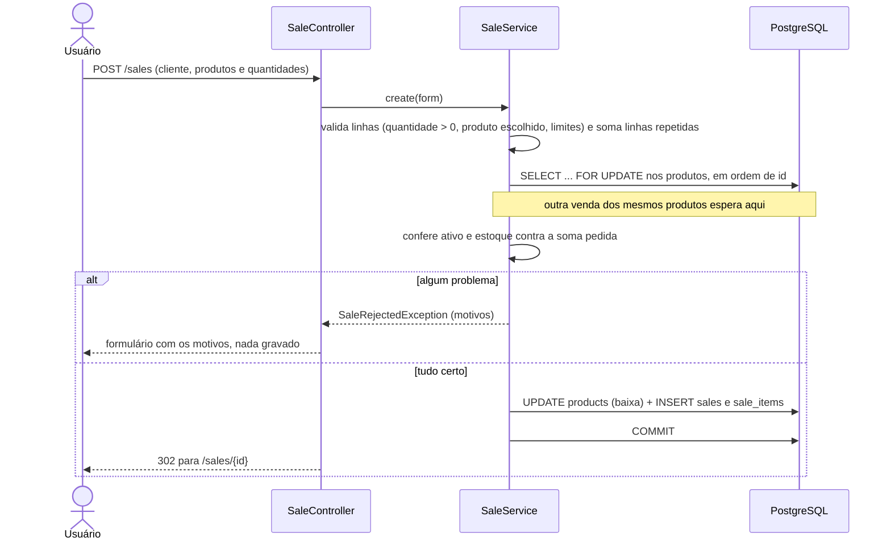

# Fluxos e endpoints

O Mini ERP é uma aplicação web server-side: cada endpoint devolve uma página Thymeleaf, um redirecionamento ou, no caso do relatório, um PDF. Não há API JSON. Formulários usam `POST` com `application/x-www-form-urlencoded`. Depois de gravar, a resposta é um redirecionamento (POST/redirect/GET), e as mensagens de sucesso ou erro chegam como atributos flash (`notice` em verde, `alert` em vermelho).

> **Todas as rotas abaixo exigem login**: sem sessão, a resposta é 302 para `/login`. Todo `POST` precisa do token CSRF (`_csrf`), que o Thymeleaf põe sozinho nos formulários; sem ele, 403. Só `/login`, `/css/**` e `/error` são públicos.

### Sessão

| Método | Caminho | Parâmetros | Resposta |
|---|---|---|---|
| GET | `/login` | `error`, `logout` (mensagens) | Página de login |
| POST | `/login` | `username`, `password`, `_csrf` | Sucesso: a página pedida antes do login, ou `/`. Erro: `/login?error` |
| POST | `/logout` | `_csrf` | Encerra a sessão e redireciona para `/login?logout` |

## Endpoints

### Produtos

| Método | Caminho | Parâmetros | Resposta |
|---|---|---|---|
| GET | `/` | | Redireciona para `/products` |
| GET | `/products` | `q` (busca por nome ou SKU), `page` (a partir de 0) | Lista paginada, 10 por página, ordenada por nome |
| GET | `/products/new` | | Formulário vazio |
| POST | `/products` | `name`, `sku`, `description`, `price`, `stockQuantity`, `active` | Sucesso: redireciona para `/products`. Erro: formulário com mensagens (200) |
| GET | `/products/{id}/edit` | | Formulário preenchido, com `version` oculto. 404 se não existir |
| POST | `/products/{id}` | os do cadastro, mais `version` | Sucesso: redireciona para `/products`. Versão desatualizada: redireciona para a edição com aviso |
| POST | `/products/{id}/delete` | | Redireciona para `/products`. Produto já vendido: aviso, nada é excluído |

### Clientes

| Método | Caminho | Parâmetros | Resposta |
|---|---|---|---|
| GET | `/customers` | `q` (nome ou e-mail parciais, ou CPF/CNPJ **completo**), `page` | Lista paginada, documento mascarado |
| GET | `/customers/new` | | Formulário vazio |
| POST | `/customers` | `name`, `email`, `document` | Sucesso: redireciona para `/customers`. Erro: formulário com mensagens |
| GET | `/customers/{id}/edit` | | Formulário com o documento formatado. 404 se não existir |
| POST | `/customers/{id}` | `name`, `email`, `document` | Como o cadastro |
| POST | `/customers/{id}/delete` | | Redireciona para `/customers`. Cliente com vendas: aviso, nada é excluído |

### Vendas

| Método | Caminho | Parâmetros | Resposta |
|---|---|---|---|
| GET | `/sales` | `page` | Lista paginada, mais recentes primeiro |
| GET | `/sales/new` | | Formulário com uma linha de item |
| POST | `/sales` com `addItem` | o formulário atual | O mesmo formulário com mais uma linha; nada é gravado |
| POST | `/sales` com `removeItem=<índice>` | o formulário atual | O formulário sem aquela linha; nada é gravado |
| POST | `/sales` | `customerId` (opcional), `items[i].productId`, `items[i].quantity` | Sucesso: redireciona para `/sales/{id}`. Recusa: formulário com a lista de motivos |
| GET | `/sales/{id}` | | Detalhe com itens, preços praticados e total. 404 se não existir |

Vendas não têm edição, exclusão nem cancelamento.

### Relatórios

| Método | Caminho | Parâmetros | Resposta |
|---|---|---|---|
| GET | `/reports/sales` | `from`, `to` (`AAAA-MM-DD`; sem os dois, o mês corrente) | Página com o resumo e as vendas do período, ou a mensagem de período inválido |
| GET | `/reports/sales.pdf` | `from`, `to` | `application/pdf`, anexo `vendas-<from>-a-<to>.pdf`. Período inválido: 303 para `/reports/sales` com os mesmos parâmetros |

### Erros

| Situação | Resposta |
|---|---|
| Registro inexistente (`/products/999/edit`) | 404 com a página "Não encontrado" |
| Caminho inexistente | 404 com a mesma página |
| Id malformado (`/products/abc/edit`) e outros erros | Página "Algo deu errado", sem stack trace (`server.error.include-stacktrace: never`) |

## Fluxos principais

### Cadastro de produto

1. O formulário é validado por Bean Validation (`ProductForm`): nome e SKU obrigatórios, preço ≥ 0 com no máximo 2 casas, estoque ≥ 0.
2. O SKU é normalizado (sem espaços nas pontas, em maiúsculas) e precisa ser único. O serviço confere antes de gravar, e a constraint `products_sku_key` decide se duas gravações correrem juntas. As duas situações viram o mesmo erro de campo.
3. Na edição, o campo oculto `version` precisa bater com o registro atual. Se uma venda ou outra edição alterou o produto depois que o formulário abriu, a gravação é recusada, para não sobrescrever o estoque baixado.

### Venda e baixa de estoque

- O navegador envia só produto e quantidade. Preço unitário, subtotais e total vêm do banco no momento da venda, e o preço fica gravado em `sale_items.unit_price`.
- Baixa de estoque e gravação da venda estão na mesma transação. Se qualquer passo falhar, o rollback devolve o estoque.
- O lock em ordem de id evita deadlock entre duas vendas com produtos em comum. O `CHECK (stock_quantity >= 0)` é a última barreira.

### Relatório de vendas

1. `SalesReportService.parsePeriod` valida as datas: as duas obrigatórias, formato ISO, inicial ≤ final e no máximo 366 dias.
2. O período vira o intervalo de instantes `[from 00:00, to + 1 dia 00:00)` no fuso `minierp.time-zone` (padrão `America/Sao_Paulo`). Assim, uma venda às 23:59 do último dia entra no relatório.
3. A página mostra os dados na hora. O PDF passa os mesmos dados, já formatados, para `reports/sales.jrxml`, e o JasperReports exporta o arquivo.

### Exclusões

Produto vendido e cliente com vendas não são excluídos: as vendas apontam para eles por FK. O serviço confere antes, e a FK garante caso uma venda aconteça no meio. Os dois casos viram o mesmo aviso. Para retirar um produto das vendas, desmarque "Ativo".

## Onde está cada regra do README

| Regra | Onde |
|---|---|
| 1. Totais no backend | `SaleItem` (subtotal a partir de `product.getPrice()`), `SaleService.create` |
| 2. Quantidade > 0 | `SaleService.validatedQuantities`; `CHECK (quantity > 0)` em `sale_items` |
| 3. Preço não negativo | `ProductForm` (`@DecimalMin`); `CHECK (price >= 0)` |
| 4. Sem venda acima do estoque | `SaleService.create`, sob `ProductRepository.findAllForUpdate` |
| 5. Venda e estoque na mesma transação | `@Transactional` em `SaleService.create` |
| 6. Preço registrado no item | `sale_items.unit_price`, que não muda depois da venda |
| 7. Cancelamento | Não implementado |
| 8. Validação na web e no serviço | Bean Validation nos forms; o `SaleService` revalida tudo o que a venda usa |
